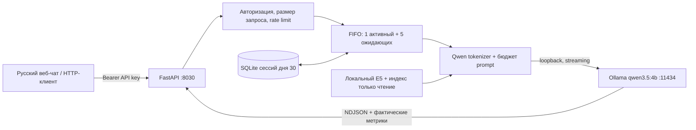

# Отчёт: День 30. Локальная LLM как приватный сервис

Дата формирования (UTC): 2026-10-11T21:35:08+00:00

## Результат

Проект создан в `D:\AIAdvent\advent-day-30-private-llm-service`. API, потоковая генерация, локальная история, RAG и очередь проверены на реальной Ollama. Windows-скрипты локального и LAN-запуска проверены. Второе устройство и визуальный браузерный прогон недоступны: они явно остаются ручными проверками.

## Модель и исходная основа

- Модель: `qwen3.5:4b`; квантование `Q4_K_M`.
- Digest: `d8b0f5e9760cd1682034f292d7ef72ec46f432149be0df7574bf2d6e92e38c04`.
- Runtime: установленный Ollama 0.40.0; `F:\LocalLLM\Ollama\ollama.exe`, существующие веса `F:\LocalLLM\models`.
- Runtime endpoint: `http://127.0.0.1:11434`; listener проверен на loopback.
- Фактическое окно из `/api/ps`: **8192**. `num_ctx` передаётся в каждом запросе и проверяется по runtime.
- Основа: день 29 (Python/Streamlit, локальный Ollama chat/streaming, E5 retrieval, SQLite, Qwen tokenizer). AGENTS.md в исходных проектах и их родительской папке не найден.
- Переиспользованы модули models/storage/embeddings/tokenization/search, чтение индекса в SQLite mode=ro, профиль sampling и подход к локальному токенизатору. Структурированный prompt дня 29 адаптирован для потокового текстового чата.
- Добавлен FastAPI для HTTP API и отдельный HTML/CSS/JS интерфейс; исходный Streamlit не предоставляет нужную многопользовательскую API-границу. История создана отдельно: прежнее хранилище не изолировало пользователей по ключу.
- Индекс и токенизатор подключены по путям. Веса и большие индексы не копировались. Облачные LLM и внешние API генерации отсутствуют.

## Схема

## Конфигурация и защита

- По умолчанию HOST=127.0.0.1, PORT=8030. Для домашней сети отдельный start-lan.ps1 с явно заданным HOST.
- API и история защищены ключом из .env/окружения. Один ключ — один пользователь; дополнительные ключи разделяют историю и rate limit. Ключ не хранится браузером постоянно и не отправляется в URL.
- 10 генераций/60 секунд/ключ; 1 одновременно; 5 в ожидании; генерация до 120 секунд; ожидание до 600 секунд; тело запроса до 65536 байт; ответ до 512 токенов.
- Контекст 8192, RAG до 2000 токенов/3 источников, до 100 сообщений истории для подготовки prompt. При переполнении удаляются старые полные пары истории и сокращаются цитаты; системные правила и последнее сообщение сохраняются.
- Текст считается локальным Qwen tokenizer, служебная обвязка имеет запас 256 + 24/сообщение. Это консервативный бюджет, а не точное воспроизведение chat template. При отсутствии tokenizer — оценка по UTF-8 байтам.
- Sampling: temperature 0, top_p 0.95, top_k 20, presence_penalty 1.5, seed 28, num_gpu 0, num_thread 4, think=false. Сохранён профиль дня 29, output уменьшен с 768 до 512.
- Журнал JSONL содержит request_id, время, HTTP/итоговый статус, длину очереди и тип ошибки; тексты и заголовки авторизации не записываются. SQLite/.env/логи исключены из Git.
- CORS по умолчанию same-origin; wildcard запрещён. HTML модели выводится текстовыми узлами, безопасное подмножество Markdown проверено тестом. CSP запрещает inline scripts и внешние ресурсы.
- Firewall, VPN, маршрутизация и роутер не менялись. Инструкции: README.md и VPN.md.

## Выполненные проверки

- Python: **20 тестов**, failures=0, errors=0; 3.185 с. Файл: reports/tests.xml.
- Эти тесты используют mock для проверки логики: 401, изоляция пользователей/сессий, сохранение/повторное открытие SQLite, 400/413/422, chunked limit, 429 + Retry-After (точный лимит 10), 503 при 1+5 и истечении ожидания, 504 и освобождение очереди, отмена, CORS, stream errors, remote-model rejection и неподтверждённое окно.
- JavaScript: node --check web/app.js; node tests/test_web_safety.cjs. Проверены безопасные текстовые узлы, Markdown, запрет javascript: в источниках и отсутствие постоянного хранения ключа. Это проверка логики, не визуальный тест браузера.
- pip check: No broken requirements found. Точные версии зафиксированы в requirements-lock.txt.
- Реальный HTTP + Ollama: **27/27 проверок** успешно; весь сценарий 55.497 с. Файл: reports/live-verification.json.
- Настоящие /health, авторизация, статические файлы чата, история, независимые сессии, RAG с цитатами, поток NDJSON, фактический token budget и очередь проверены через HTTP-сокет.

## Пять одновременных запросов

Запросы запускались одновременно. Порядок ниже — фактическое поступление в очередь, а не номер задачи клиента. У всех HTTP 200; все пять маркеров в ответах точно совпали со своими запросами; у всех разные request_id и session_id. Одновременно наблюдалась одна активная генерация и до четырёх ожидающих.

| Маркер / ответ | Время клиента, с | Очередь, с | Обработка, с | Вход / выход, токенов |
|---|---:|---:|---:|---:|
| LOCAL30-1-OK | 3.822 | 0.000 | 3.687 | 215 / 8 |
| LOCAL30-2-OK | 7.484 | 3.687 | 3.641 | 215 / 8 |
| LOCAL30-5-OK | 11.309 | 7.312 | 3.813 | 215 / 8 |
| LOCAL30-4-OK | 15.201 | 11.125 | 3.875 | 215 / 8 |
| LOCAL30-3-OK | 19.009 | 14.984 | 3.813 | 215 / 8 |

Все ответы сверены с историей соответствующей сессии. Очередь приложения опустела; процесс продолжил принимать запросы. Лимит именно пяти ожидающих и отказ шестому дополнительно проверен детерминированным тестом.

## Другие измерения и восстановление

| Сценарий | Результат | Измеренное время, с |
|---|---|---:|
| Первый ответ | HTTP 200 | 0.600 |
| Ответ с памятью | HTTP 200 | 4.088 |
| RAG с источниками | HTTP 200 | 23.167 |
| Реальный stream: первый фрагмент / весь запрос | done, текст совпал с суммой delta | 7.084 / 8.036 |
| forced_timeout | HTTP 504 | 0.172 |
| after_timeout | HTTP 200 | 114.707 |
| unavailable_runtime | HTTP 503 | 2.037 |
| after_runtime_restore | HTTP 200 | 4.383 |

Проверка восстановления использовала реальные соединения с Ollama и отдельную БД: timeout принудительно уменьшен до 0,05 с, затем возвращён к 120 с. Для отказа runtime выбран реальный локальный TCP-порт без listener, после чего восстановлен исходный URL. Mock LLM здесь не использовалась. Обработчики API проверялись в процессе теста; полный socket HTTP проверен основным сценарием. Файл: reports/recovery-verification.json.

## Windows и сеть

- Локальный listener: ['127.0.0.1']; /health после повторного запуска: ok.
- LAN listener: ['0.0.0.0']; /health с того же ПК: ok.
- Ollama listener: ['127.0.0.1'].
- Сохранённая история доступна через API после перезапуска процесса: True.
- Подтверждено только переключение bind-адреса приложения. Запрос с того же компьютера не считается проверкой доступа другого устройства.

## Обнаруженные проблемы и исправления

- Windows cp1252 не позволяла печатать русские сообщения setup: исправлено явным UTF-8.
- Разбор TEMPERATURE=0.0 выявил неверный исходный тип значения по умолчанию: исправлен и покрыт тестом чтения .env.example.
- Свежая CPU-сборка PyTorch 2.14.1 не загружала c10.dll (WinError 1114). Установлена и закреплена рабочая версия дня 29 — 2.6.0+cpu. После исправления настоящий E5 поиск и RAG прошли.
- При частичной загрузке RAG индекс мог ошибочно означать готовность. Публикация готового состояния стала атомарной после загрузки embedding-модели.
- Исправлено освобождение слота при отмене ещё не стартовавшей coroutine. Тест подтверждает восстановление ёмкости очереди.
- Исходный неуспешный RAG-прогон сохранён в reports/initial-rag-failure.json; итоговые измерения приведены из повторного успешного прогона.

- Ответ после принудительного таймаута занял 114.707 с, хотя завершился успешно. Причина этой задержки отдельно не установлена. Время ответа может заметно меняться; очередь приложения не управляет другими клиентами того же Ollama.

## Контроль исходных проектов

Проверено 280 файлов по SHA-256; 21 файлов модели — по размеру и mtime. Полная проверка неизменности: **False**.

Во время выполнения обнаружены параллельные изменения файлов дня 29, перечисленных ниже. Команды этой реализации не редактировали исходные проекты; обнаруженные изменения не откатывались. Поэтому полную неизменность исходной папки в течение сеанса утверждать нельзя. Скопированные модули retrieval, профиль, индексы и токенизаторы не изменились; размер/mtime файлов весов совпали.

- `D:\AIAdvent\advent-day-29-optimized-local-rag\README.md`
- `D:\AIAdvent\advent-day-29-optimized-local-rag\src\document_indexer\optimization.py`
- `D:\AIAdvent\advent-day-29-optimized-local-rag\src\document_indexer\optimization_store.py`
- `D:\AIAdvent\advent-day-29-optimized-local-rag\tests\test_optimization.py`
- `D:\AIAdvent\advent-day-29-optimized-local-rag\tests\test_optimization_ui.py`
- `D:\AIAdvent\advent-day-29-optimized-local-rag\ui\views\optimization.py`

Полный снимок сравнения: reports/source-preservation.json. В отчёте содержатся только хеши .env, не его значения.

## Что требует ручной проверки

- Встроенный браузер в этой сессии недоступен (список браузеров пуст). Визуальное отображение и клики на компьютере/телефоне не выдаются за выполненные проверки. HTTP assets, JavaScript syntax и безопасный renderer проверены автоматически.
- Телефон в той же сети: открыть LAN-IP компьютера, проверить неверный/верный ключ, поток ответа, RAG-источники, новую и старую сессию, узкий экран и сохранение ввода при ошибке.
- Перезагрузка страницы должна очистить ключ, после повторного ввода история снова доступна.
- Доступ по мобильному интернету через самостоятельно настроенную VPN; вне VPN сервис недоступен. Firewall и изоляцию Wi-Fi проверить на реальных устройствах.
- Подробный сценарий: README.md, раздел «Ручная проверка с телефона».

## Дополнительная проверка реального Android по USB — 2026-10-12

В 00:13 (+02:00) подключён Android, определившийся как модель `21091116UG`, со статусом ADB `device`. Настроен `adb reverse tcp:8030 tcp:8030`; `reverse --list` подтвердил `UsbFfs tcp:8030 tcp:8030`.

HTTP-проверки выполнены командой curl непосредственно на телефоне через ADB shell, по USB-пробросу, а не запросом с Windows к собственному LAN-IP:

- `GET http://127.0.0.1:8030/health`: HTTP 200, `status=ok`, `service=private-llm`, версия 1.0.0.
- `GET http://127.0.0.1:8030/`: HTTP 200.
- `GET http://127.0.0.1:8030/api/status` без ключа: HTTP 401, `error.code=unauthorized`.
- На телефоне выполнен Android VIEW intent для открытия `http://127.0.0.1:8030/` в браузере.

Firewall изменить не удалось: Windows отказала в доступе, повышение прав через UAC не выполнено. USB-доступ проверен без изменения Firewall. Сервис работает в ранее настроенном LAN-режиме; Ollama остаётся локальным.

Автоматически не проверялись ввод ключа и генерация в браузере телефона, визуальное отображение, Wi-Fi и VPN. Эти проверки по-прежнему требуют ручного выполнения. API-ключ на телефон командами не передавался.
